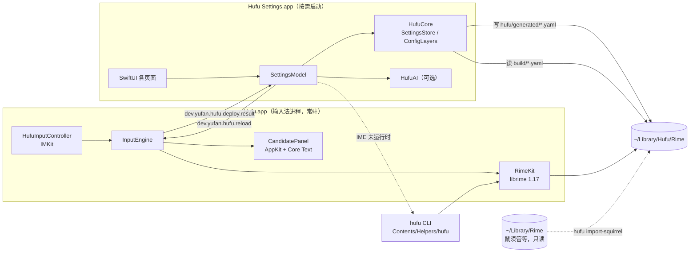

# Hufu 架构

> 状态：MVP（v0.1）· 最后更新 2026-10-21

Hufu 是 librime 的一个新前端：输入法本体用 InputMethodKit + AppKit 实现，配置管理用 SwiftUI 实现，
两者之间只通过**文件**和**分布式通知**交互。只内置虎码方案（`tigress`）；方案、词库与补丁格式仍遵循 RIME。
虎码官方数据通过 `dicts/huma` git submodule（[hufu-scheme](https://github.com/syhily/hufu-scheme)）引入，
方案定制（词表裁剪、schema 调整）全部在方案仓库完成；构建时 `scripts/stage-huma.sh` 组装并预编译 librime 二进制产物。
安装包不捆绑任何 librime 插件：只随包分发 `librime.1.dylib`、OpenCC 数据与虎码方案/词库。



## 模块

| 模块 | 位置 | 职责 | 依赖 |
|---|---|---|---|
| CRime | `Packages/HufuKit/Frameworks/CRime.xcframework` | librime 预编译二进制与头文件（由 `scripts/fetch-librime.sh` 组装，不入库） | — |
| RimeKit | `Packages/HufuKit/Sources/RimeKit` | librime C API 的类型化 Swift 封装：引擎生命周期、会话、按键映射、配置读取 | CRime |
| HufuCore | `Packages/HufuKit/Sources/HufuCore` | 配置值模型、三层补丁合成、设置目录、导入器、自定义短语 | Yams |
| HufuPanel | `Packages/HufuKit/Sources/HufuPanel` | 候选窗：主题解析、Core Text 布局与绘制；设置 App 的预览复用同一视图 | HufuCore |
| HufuAI | `Packages/HufuKit/Sources/HufuAI` | 可选 AI 助手：Provider 抽象、自然语言改配置、文本抽词 | HufuCore |
| hufu | `Packages/HufuKit/Sources/hufu` | 命令行：deploy / bench / doctor / diagnostics / import-squirrel / get / set / sync / register | RimeKit, HufuCore |
| Hufu.app | `Apps/Hufu` | IMK 输入法服务 | RimeKit, HufuCore, HufuPanel |
| Hufu Settings.app | `Apps/HufuSettings` | 可视化设置（**不链接 librime**） | HufuCore, HufuPanel, HufuAI |

## 目录

```
~/Library/Input Methods/Hufu.app/Contents/
  MacOS/Hufu                      输入法进程
  Helpers/hufu                    CLI（不能放 MacOS/：文件系统大小写不敏感，会覆盖 Hufu）
  Applications/Hufu Settings.app  设置
  Frameworks/librime.1.dylib
  SharedSupport/                  只读数据：虎码方案与词库（dicts/huma submodule 直接采用，定制在方案仓库完成）、
                                  OpenCC（librime 库存 + 方案的拆分/拼音/emoji 表 + 产品层 st_tu 简繁表）、hufu.yaml、hufu/defaults、build/（预编译产物）

~/Library/Hufu/Rime/              用户目录（librime user_data_dir）
  default.custom.yaml …           由 Hufu 合成的补丁（勿手改）
  hufu/imported/*.custom.yaml     手写补丁层（导入的其他 RIME 配置原样存放于此）
  hufu/generated/*.yaml           设置 App 写入的可视化配置层
  hufu/backup/                    安装包时被覆盖文件的备份
  build/                          librime 编译产物
~/Library/Logs/Hufu/              librime 日志（默认 WARNING 级别，不记录输入内容）
```

## 关键流程

### 按键

`IMKInputController.handle` → `RimeKey.translate`（keyCode → X11 keysym + 修饰键掩码）→
`process_key` → `get_commit` / `get_context` → `insertText` / `setMarkedText` + 候选窗更新。
全部在主线程同步完成；性能数据以 CI 的 `hufu bench`（tigress 方案）为准。

### 配置写入与部署

1. 设置 App 把改动写入 `hufu/generated/<name>.yaml`，并重新合成 `<name>.custom.yaml`
   （defaults → imported → generated，后者覆盖前者，见 ADR-0003）。
2. 被修改的目标记入 `hufu/.dirty`；部署前删除其 `build/` 产物，规避 librime 秒级时间戳比较。
3. 点击「部署」：若输入法进程在运行，发送 `dev.yufan.hufu.reload`，输入法清理会话 → 重新初始化 →
   部署 `hufu.yaml` → `start_maintenance`，完成后回发 `dev.yufan.hufu.deploy.result`；
   否则调用捆绑 CLI `hufu deploy`。
4. 手写补丁层如需调整，可先用 `hufu deploy --dry-run` 在临时副本上校验，失败自动回滚；设置 App 不提供原始 YAML 编辑。

librime 的「工作区更新」只编译 `default.yaml` 和各方案；前端配置 `hufu.yaml` 需要前端自己
`deploy_config_file`（鼠须管对 `squirrel.yaml` 也是如此）。另外 librime 在单个方案编译失败时
仍报告整体成功，所以 `hufu deploy` 会逐一核对 `schema_list` 中每个方案的产物是否存在。

### 导入其他 RIME 配置

`hufu import-squirrel --from <目录>`（或设置 App 概览页一键导入）只读源目录：复制词库、
OpenCC、自定义短语、配色与词频快照（APFS 克隆，不额外占空间）；`squirrel.custom.yaml` 作为外观补丁
映射为前端配置，其余 `*.custom.yaml`（`default` 与方案补丁）属于方案定制，跳过不导入；跳过 `build/`、
`*.userdb`（源输入法正在使用的 LevelDB）、`installation.yaml`、`user.yaml`。导入器不限于鼠须管；
拼音码表需要用户自行改成虎码编码。若复制了 `sync/*/*.userdb.txt`，会在部署后用 `sync_user_data` 合并词频。

## 性能预算

| 指标 | 目标 | 现状 |
|---|---|---|
| 单键处理 p99（process_key + get_context） | ≤ 5 ms | 由 CI `hufu bench` 记录 |
| 候选窗更新 | 单次布局 + 绘制，无 Auto Layout / SwiftUI | `os_signpost` 区间 `panel.update` |
| 首次部署（虎码全量） | 后台进行，不阻塞打字 | — |
| 增量部署（改一个设置） | — | — |

CI 以 `hufu bench --assert-p99-ms 5` 作为性能门禁。
